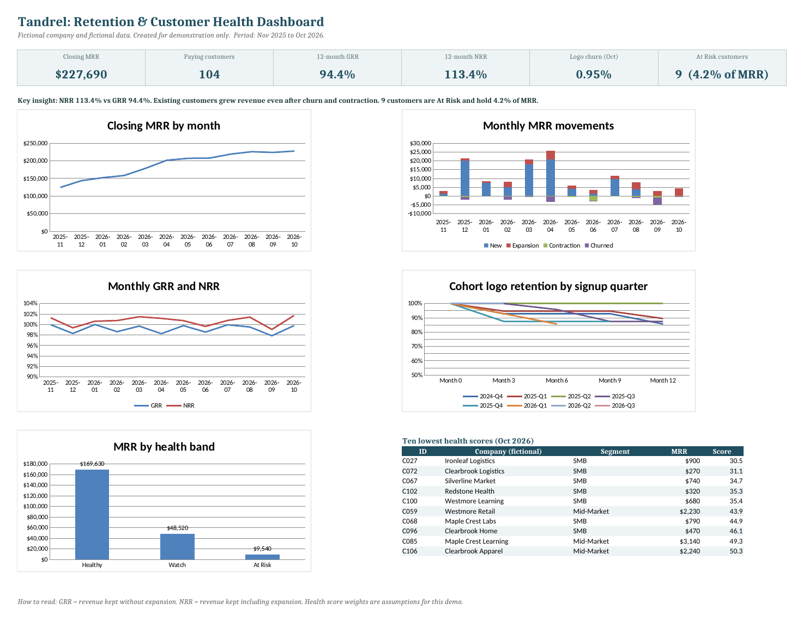

# Tandrel: Retention & Customer Health Analytics

A SQL, Python and Excel project that checks subscription data, measures revenue retention, and scores customer health for a B2B SaaS company.

> **Everything here is fictional.** Tandrel is an imaginary company. All customers, names and numbers are made up and generated by a script. They are for demonstration only. This is not a real client project and it shows no real business results.

---

## 1. Project Overview

Tandrel is an imaginary SaaS company. It sells an AI support chatbot to online businesses.

This project turns four raw monthly files into one report:

- A monthly **MRR bridge** (new, expansion, contraction and churned revenue).
- **GRR and NRR** (revenue retention).
- **Cohort retention** by signup quarter.
- A **customer health score** that uses revenue, usage and chatbot support data.
- A one-page **Dashboard** tab with KPI tiles and charts.
- A **data check** tab that shows what was wrong in the raw data and how it was handled.

The process is one command. Data checks run first. The report only builds if the numbers reconcile.

## 2. Business Problem

Leadership at a SaaS company keeps asking two questions: *Are we keeping our revenue?* and *Which customers might leave?*

The answers are often slow and inconsistent because:

- Revenue data and support data sit in different files.
- Reports are built by hand each month.
- Duplicates, gaps and bad values go unnoticed.
- Nobody checks that the totals add up before the report is shared.

A repeatable process with built-in checks fixes this. Two people running it on the same data get the same numbers.

## 3. Project Objectives

1. Check the raw data and clean it with clear, written rules.
2. Build a monthly MRR bridge that adds up to closing MRR.
3. Calculate GRR, NRR and cohort retention.
4. Give each paying customer a health score and a band: Healthy, Watch or At Risk.
5. Stop the build if any reconciliation check fails.

## 4. Dataset Description

All data is fictional. It covers 24 months (Nov 2024 to Oct 2026) for 120 customers. The report period is the last 12 months (Nov 2025 to Oct 2026).

| File | Rows | What it holds |
|---|---|---|
| `customers.csv` | 120 | One row per customer: `customer_id`, `company_name`, `segment` (SMB, Mid-Market, Enterprise), `industry`, `region`, `signup_date`, `plan` |
| `mrr_monthly.csv` | 1,569 | One row per customer per month: `mrr` and `status` (active or churned). A churned customer has one row with `mrr = 0` in the month it leaves. |
| `usage_monthly.csv` | 1,548 | `active_users` and `conversations_handled` for each customer and month |
| `support_monthly.csv` | 1,552 | Chatbot results: `chats`, `bot_resolved`, `handed_to_agent`, `csat_responses`, `csat_avg` |

**Problems planted on purpose.** The generator adds a few known problems, so the checks have something to find:

- 6 duplicate MRR rows and 4 duplicate support rows
- 2 missing MRR values and 1 negative MRR value
- 1 missing month in a customer's MRR history
- 3 CSAT scores outside 1 to 5
- 1 customer id (`C999`) that is not in the customer list

**Built-in pattern.** About 1 in 8 older customers are set to decline in the last 6 months (lower usage, lower bot-resolved share, lower CSAT). This is built in so the health score has something to find. It does not prove the score works on real data.

## 5. Methodology

1. **Load** the four raw CSV files into an in-memory SQLite database.
2. **Check** the raw data with SQL (`01_data_checks.sql`). A second set of checks is written in pandas. The two must agree.
3. **Clean** the data with the written rules in `validate_data.py` (see section 8).
4. **Calculate** the MRR bridge, GRR, NRR, cohorts and health scores with SQL.
5. **Reconcile** the results (see section 8). The script stops if a check fails.
6. **Write** the Excel report.

**Limits.** The data is fictional. The health score weights are my own assumptions and were not tested on real data. Use the score to rank customers for a review, not to predict churn.

## 6. Tools Used

| Tool | Used for |
|---|---|
| **SQL (SQLite)** | Data checks, MRR bridge (CTEs and `LAG()` window function), GRR and NRR, cohort retention, health score |
| **Python (pandas, openpyxl)** | Dummy data generator, cleaning rules, pandas cross-checks, reconciliation, building the Excel file |
| **Excel** | The final report: Dashboard (charts), Summary, MRR Bridge, Retention, Cohorts, Health Scores, Data Checks |

## 7. SQL Queries

All SQL files are in `sql/`. The Python script runs them in order.

| File | What it does |
|---|---|
| `01_data_checks.sql` | Counts data problems in the raw tables |
| `02_mrr_bridge.sql` | Builds the monthly MRR bridge |
| `03_grr_nrr.sql` | Calculates GRR and NRR (monthly and 12-month) |
| `04_cohort_retention.sql` | Retention by signup quarter at 0, 3, 6, 9 and 12 months |
| `05_health_score.sql` | Health score and band for each paying customer |

### Query 1: What each customer did to MRR each month

`LAG()` reads last month's MRR for the same customer. The `CASE` rules sort every change into new, expansion, contraction or churn.

```sql
CREATE VIEW mrr_movements AS
SELECT customer_id,
       month,
       mrr,
       COALESCE(prev_mrr, 0) AS prev_mrr,
       CASE WHEN COALESCE(prev_mrr, 0) = 0 AND mrr > 0              THEN mrr             ELSE 0 END AS new_mrr,
       CASE WHEN prev_mrr > 0 AND mrr > prev_mrr                    THEN mrr - prev_mrr  ELSE 0 END AS expansion_mrr,
       CASE WHEN prev_mrr > 0 AND mrr > 0 AND mrr < prev_mrr        THEN prev_mrr - mrr  ELSE 0 END AS contraction_mrr,
       CASE WHEN prev_mrr > 0 AND mrr = 0                           THEN prev_mrr        ELSE 0 END AS churned_mrr
FROM (
    SELECT customer_id,
           month,
           mrr,
           LAG(mrr) OVER (PARTITION BY customer_id ORDER BY month) AS prev_mrr
    FROM clean_mrr
);
```

### Query 2: The monthly MRR bridge

This adds the customer movements up for each month. Opening MRR + new + expansion - contraction - churn must equal closing MRR. The script checks this.

```sql
CREATE VIEW mrr_bridge_all AS
SELECT month,
       SUM(prev_mrr)        AS opening_mrr,
       SUM(new_mrr)         AS new_mrr,
       SUM(expansion_mrr)   AS expansion_mrr,
       SUM(contraction_mrr) AS contraction_mrr,
       SUM(churned_mrr)     AS churned_mrr,
       SUM(mrr)             AS closing_mrr,
       SUM(CASE WHEN prev_mrr > 0     THEN 1 ELSE 0 END) AS opening_customers,
       SUM(CASE WHEN new_mrr > 0      THEN 1 ELSE 0 END) AS new_customers,
       SUM(CASE WHEN churned_mrr > 0  THEN 1 ELSE 0 END) AS churned_customers,
       SUM(CASE WHEN mrr > 0          THEN 1 ELSE 0 END) AS closing_customers
FROM mrr_movements
GROUP BY month;
```

### Query 3: 12-month GRR and NRR

Take the customers who were paying in the base month (`2025-10`). Then look at what the same customers pay in the latest month (`2026-10`). New customers are left out. NRR counts expansion. GRR caps each customer at its starting MRR, so expansion does not count.

```sql
WITH base AS (
    SELECT customer_id, mrr
    FROM clean_mrr
    WHERE month = :base_month AND mrr > 0
),
latest AS (
    SELECT customer_id, mrr
    FROM clean_mrr
    WHERE month = :latest_month
)
SELECT COUNT(*)                                              AS starting_customers,
       SUM(CASE WHEN COALESCE(l.mrr, 0) > 0 THEN 1 ELSE 0 END) AS retained_customers,
       SUM(b.mrr)                                            AS starting_mrr,
       SUM(COALESCE(l.mrr, 0))                               AS ending_mrr_same_customers,
       SUM(MIN(b.mrr, COALESCE(l.mrr, 0)))                   AS retained_mrr_capped,
       ROUND(1.0 * SUM(COALESCE(l.mrr, 0)) / SUM(b.mrr), 4)  AS nrr_12m,
       ROUND(1.0 * SUM(MIN(b.mrr, COALESCE(l.mrr, 0))) / SUM(b.mrr), 4) AS grr_12m
FROM base b
LEFT JOIN latest l ON l.customer_id = b.customer_id;
```

The cohort query and the health score query are longer. They are in `sql/04_cohort_retention.sql` and `sql/05_health_score.sql`, with comments.

## 8. Data Validation

### Checks on the raw data

Each check runs twice: once in SQL and once in pandas. The script stops if the two disagree.

| Check | Records flagged | How it was handled |
|---|---|---|
| Duplicate rows in `mrr_monthly` | 6 | Keep the first row for each customer and month |
| Duplicate rows in `support_monthly` | 4 | Keep the first row for each customer and month |
| Missing MRR values | 2 | Treated as missing. Use the previous month's MRR |
| Negative MRR values | 1 | Treated as missing. Use the previous month's MRR |
| Missing months in MRR history | 1 | Add the month. Use the previous month's MRR |
| CSAT score outside 1 to 5 | 3 | Set the score to empty |
| Unknown `customer_id` (3 files, 3 rows each) | 9 | Remove the rows |
| Chat volume differs between usage and support files | 0 | No action needed |

Using the previous month's MRR is an assumption. It is the safest simple rule for a small gap. A real team would confirm it with the billing owner.

### Reconciliation checks on the final numbers

All 8 pass. They are also listed on the `Data Checks` tab.

1. The MRR bridge adds up in every month.
2. Opening MRR of a month equals closing MRR of the month before.
3. 12-month NRR and GRR from SQL match a separate pandas calculation.
4. Clean MRR rows = raw rows - duplicates - unknown customers + months added.
5. No duplicate customer and month rows remain.
6. The health table has one row for every paying customer in the latest month.
7. All health scores are between 0 and 100.
8. Latest closing MRR equals the MRR total in the health table.

## 9. KPI Definitions

| KPI | Formula | What it tells a business user |
|---|---|---|
| **MRR** | Sum of monthly recurring revenue from paying customers | The size of the recurring revenue base |
| **New MRR** | MRR from customers who had no MRR last month | Revenue from new customers |
| **Expansion MRR** | Increase in MRR from existing customers | Upsell and growth inside the base |
| **Contraction MRR** | Decrease in MRR from customers who stay | Downgrades |
| **Churned MRR** | Last month's MRR of customers who left | Revenue lost to cancellations |
| **Logo churn %** | Customers lost / customers at the start of the month | How many customers leave |
| **GRR** | (Opening - churned - contraction) / opening | How much revenue is kept. It cannot be above 100%. |
| **NRR** | (Opening - churned - contraction + expansion) / opening | Whether existing customers grow or shrink in value. Above 100% means growth. |
| **Cohort retention** | Customers (or MRR) left N months after signup / cohort start | Whether newer cohorts keep customers better than older ones |
| **Health score (0 to 100)** | 35% usage trend + 20% bot-resolved + 15% handoff + 30% CSAT | Which customers need attention first |

**Health score details** (all weights and limits are assumptions):

| Part | Weight | How it becomes points |
|---|---|---|
| Usage trend | 35% | Recent 3-month average chats / prior 3-month average. 0.70 gives 0 points. 1.10 or more gives 100. |
| Bot-resolved share | 20% | Share of chats the bot resolved. 60% or more gives 100 points. |
| Handoff share | 15% | Share of chats handed to an agent. 0% gives 100 points. 40% or more gives 0. |
| CSAT | 30% | Weighted average CSAT. 1 gives 0 points. 5 gives 100. |

A part that cannot be measured (a new customer, or no CSAT answers) gets a neutral 50. Bands: **Healthy** 70 and above, **Watch** 50 to 69.9, **At Risk** below 50.

## 10. Sample Output

The full report is `output/Tandrel_Retention_Health_Report.xlsx`. It has a Dashboard tab first, then Summary, MRR Bridge, Retention, Cohorts, Health Scores, Data Checks and a Chart Data tab that feeds the charts.

**Dashboard (fictional data)**



**Summary (Oct 2026, fictional data)**

| Metric | Value |
|---|---|
| Closing MRR | $227,690 |
| MRR change over 12 months | 87.2% |
| Paying customers | 104 |
| 12-month GRR | 94.4% |
| 12-month NRR | 113.4% |
| Logo churn, Oct 2026 | 0.95% |
| Customers At Risk | 9 |
| MRR held by At Risk customers | 4.2% |

**Health bands (Oct 2026)**

| Band | Customers | MRR | % of MRR |
|---|---|---|---|
| Healthy | 70 | $169,630 | 74.5% |
| Watch | 25 | $48,520 | 21.3% |
| At Risk | 9 | $9,540 | 4.2% |

**MRR bridge, last 3 months**

| Month | Opening | New | Expansion | Contraction | Churned | Closing |
|---|---|---|---|---|---|---|
| 2026-08 | $218,990 | $3,850 | $4,130 | $570 | $470 | $225,930 |
| 2026-09 | $225,930 | $0 | $2,760 | $700 | $4,160 | $223,830 |
| 2026-10 | $223,830 | $0 | $4,340 | $220 | $260 | $227,690 |

**Lowest health scores**

| Customer | Segment | MRR | Usage ratio | Bot-resolved | Handoff | CSAT | Health score |
|---|---|---|---|---|---|---|---|
| Ironleaf Logistics | SMB | $900 | 0.67 | 43.8% | 41.6% | 3.12 | 30.5 |
| Clearbrook Logistics | SMB | $270 | 0.54 | 40.9% | 43.5% | 3.32 | 31.1 |
| Silverline Market | SMB | $740 | 0.71 | 39.9% | 33.5% | 3.44 | 34.7 |

**What the dummy data shows.** NRR is above 100%, so existing customers grew revenue even after churn and contraction. Nine customers are At Risk and 25 are on Watch. At Risk customers hold only 4.2% of MRR, so a first review list is short. These findings only show how the report reads. They are not real results.

## 11. Automation Workflow

These steps run in one command (`python scripts/build_report.py`):

1. Load the files and run the data checks.
2. Compare the SQL checks with the pandas checks.
3. Clean the data with the written rules.
4. Run the KPI SQL.
5. Run the reconciliation checks. Stop if one fails.
6. Write the formatted Excel report.

For a new month, replace the CSV files and update the month settings at the top of `build_report.py` (`PARAMS`). The steps above do not change. This replaces copy-and-paste work with a script that stops loudly when the data does not add up.

**Not automated:** scheduling, loading data from a live system, and sending the report. They are outside this demo.

## 12. Key Learnings

- Define each metric first. GRR and NRR look alike, but they answer different questions. Writing the formula down first avoids arguments later.
- Check the data before the analysis. A duplicate row or a missing month changes MRR quietly.
- Reconcile every result. A bridge that adds up and a second calculation that matches give confidence in the numbers.
- Write down assumptions. The health weights and the "use last month's MRR" rule are choices. They belong in the README, not hidden in code.
- Keep logic and presentation apart. SQL holds the business logic. Python builds the file. The logic can be reviewed without opening Excel.
- Be careful with claims. A health score built on fictional data shows a method. It does not show that the score predicts churn.

## 13. How to Run the Project

You need Python 3.9 or newer. Python's built-in SQLite must be version 3.25 or newer (for window functions).

```bash
# 1. Install the libraries
pip install -r requirements.txt

# 2. (Optional) Create the fictional data again. The data files are already included.
python scripts/generate_dummy_data.py

# 3. Check the data, run the SQL and build the report
python scripts/build_report.py
```

The report is written to `output/Tandrel_Retention_Health_Report.xlsx`.

To see only the data checks and the cleaning log, run `python scripts/validate_data.py`.

## Project Structure

```
tandrel-retention-health-analytics/
├── README.md
├── requirements.txt
├── data/
│   ├── customers.csv
│   ├── mrr_monthly.csv
│   ├── usage_monthly.csv
│   └── support_monthly.csv
├── sql/
│   ├── 01_data_checks.sql
│   ├── 02_mrr_bridge.sql
│   ├── 03_grr_nrr.sql
│   ├── 04_cohort_retention.sql
│   └── 05_health_score.sql
├── scripts/
│   ├── generate_dummy_data.py
│   ├── validate_data.py
│   └── build_report.py
└── output/
    ├── Tandrel_Retention_Health_Report.xlsx
    └── Tandrel_Dashboard.png
```
